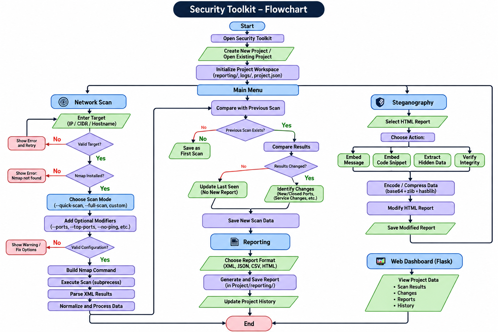

# Security Toolkit

**Author:** Adrian Carrasco

Security Toolkit is a modular cybersecurity project focused on automating network reconnaissance, generating structured reports, and experimenting with steganography in controlled environments.

The main goal is to simplify repetitive Nmap workflows while learning how Nmap behaves internally when executed through Python subprocesses and how its results can be processed programmatically.

---

## Objectives

- Automate repetitive Nmap commands using easier-to-remember Python flags.
- Learn how to execute and manage the native Nmap binary using Python subprocesses.
- Generate structured reports from scan results.
- Compare new scan results with previous ones and avoid unnecessary duplicated data.
- Use steganography techniques to embed and extract messages, files, images, or report data in controlled environments. JUST FOR HTML REPORTS.
- Build a modular security toolkit that can later include additional cybersecurity utilities.

---

## Technology Stack

- Python
- Flask
- HTML
- CSS
- JavaScript
- Nmap

---

# Network Scanning

The network scanning module uses the native Nmap binary installed on the system.

Python is responsible for:

- Processing user arguments
- Building Nmap commands
- Executing Nmap through subprocesses
- Handling errors
- Parsing scan results
- Generating reports

---

## Basic Scan Options

### `--quick-scan`

Performs a faster reconnaissance scan.

Planned Nmap behavior:

- Fast port scan (`-F`)
- SYN scan (`-sS`)
- Timing profile 3 (`-T3`)

Example:

`python3 security_toolkit.py TARGET --quick-scan`

---

### `--full-scan`

Performs a more detailed TCP scan.

Planned functionality includes:

- TCP scanning
- Service/version detection (`-sV`)
- Default NSE scripts

The final Nmap configuration for this profile may change during development.

---

# Intermediate Scan Options

### `--ports`

Scan specific ports.

Example:

`--ports 22,80,443,445`

---

### `--top-ports`

Scan a specific number of the most commonly used ports.

Example:

`--top-ports 5000`

---

### `--all-ports`

Scan the complete TCP port range.

Equivalent to scanning approximately 65,535 ports.

---

### `--timing`

Select the Nmap timing profile.

Planned values:

- 1 — slow
- 2 — conservative
- 3 — normal
- 4 — aggressive
- 5 — very aggressive

Example:

`--timing 2`

---

### `--enum-hosts`

Perform host discovery to identify active hosts on a network.

Useful when scanning CIDR ranges such as:

`192.168.1.0/24`

---

### `--no-ping`

Skip the normal host-discovery phase.

This can be useful in laboratory environments where hosts do not respond to discovery probes.

Equivalent Nmap functionality:

`-Pn`

---

### `--os-discovery`

Attempt to identify the target operating system using Nmap OS detection.

OS detection may not always return an accurate result depending on network conditions and host responses.

---

# Advanced Scan Options

### `--decoy`

Experimental option intended for controlled laboratory testing of Nmap decoy functionality.

---

### `--hide-real-port`

Experimental networking option.

The exact behavior of this functionality is still being designed and will be documented before implementation.

---

### `--fragment-packets`

Experiment with fragmented network packets in controlled environments.

Nmap packet fragmentation works with fragment sizes based on multiples of 8 bytes.

This feature is intended for laboratory testing and network-analysis learning.

---

### `--script`

Run one or more installed Nmap NSE scripts.

Multiple scripts can be separated by commas.

Example:

`--script http-title,http-headers`

The toolkit will rely on NSE scripts installed with the local Nmap installation.

Common Linux installations store these scripts under:

`/usr/share/nmap/scripts`

---

### `--nmap-args`

Pass additional advanced arguments directly to the native Nmap binary.

This option is intended for advanced users when the toolkit does not yet provide a dedicated flag for a specific Nmap capability.

Example:

`--nmap-args "-Pn -sV"`

---

# Reporting

Security Toolkit will process Nmap results and support multiple output formats.

## Raw Format

### XML

Nmap XML output will be used as the primary raw scan format.

XML provides structured data that can later be parsed by Python.

---

## Structured Formats

### JSON

Useful for:

- Programmatic processing
- APIs
- Storing structured scan data
- Comparing different scans

### CSV

Useful for:

- Spreadsheet analysis
- Port/service lists
- Data export
- Quick filtering

---

## Human-Readable Format

### HTML

HTML reports will provide a visual representation of scan results.

The planned Flask interface will allow users to view information such as:

- Target information
- Active hosts
- Open ports
- Detected services
- Service versions
- Operating system guesses
- NSE script output
- Previous scan history
- Changes between scans

---

# Planned Project System

Security Toolkit will support project-based workspaces.

A user will be able to create a project such as:

`Enterprise_Network_X`

The toolkit will automatically create a workspace for that assessment.

Planned structure:

SecurityToolkitProjects/

Enterprise_Network_X/

- reporting/
- logs/
- project configuration

Optional modules such as steganography may be added to an existing project later.

---

# Scan History

The toolkit is planned to support scan comparison.

When a target is scanned multiple times:

- New results will be compared with previous results.
- Duplicate information should not create unnecessary report copies.
- Relevant changes will be stored.
- Newly discovered ports or services will be highlighted.
- Removed or changed services may also be identified.

Example:

Previous scan:

- 22/tcp — SSH
- 80/tcp — HTTP

New scan:

- 22/tcp — SSH
- 80/tcp — HTTP
- 3306/tcp — MySQL

Detected change:

`+ 3306/tcp MySQL`

---

# Steganography

The steganography module will be optional.

Its purpose is to study data embedding and extraction techniques in controlled environments.

Planned functionality may include:

- Hide text inside supported carrier files
- Hide files
- Extract hidden data
- Store report data inside supported formats
- Analyze files for embedded content

This module is intended for educational and authorized security research.

---

## Project Flow

The following diagram shows the general workflow of Security Toolkit:

---

## Disclaimer

Security Toolkit is intended for educational purposes, cybersecurity laboratories, and systems where the user has explicit authorization to perform security testing.

The author is not responsible for unauthorized or illegal use of this software.
